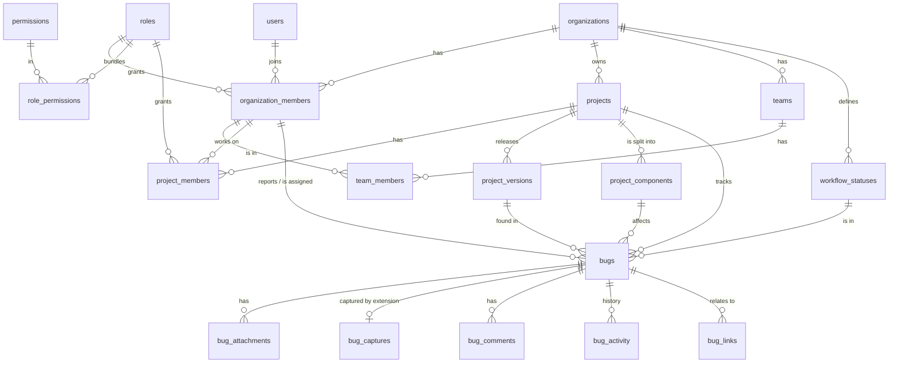

# UpTrack database design

This is the relational schema UpTrack runs on as a multi-organization bug tracker. Organizations such as Null Void Studio sign up, add developers and SQA engineers, create projects such as Uptrack, and release versions of them. SQA engineers report bugs against a specific project version.

The full, runnable DDL is the first migration, [`db/migrations/0001_init.sql`](../../db/migrations/0001_init.sql). It targets **PostgreSQL 18**. It has been loaded into PostgreSQL 18.6 and checked with 39 scenario tests: the reporting flow, plus attempts to create invalid data that the schema must reject (see [Validation](#validation)).

Later migrations add to it:

- [`0002_sessions.sql`](../../db/migrations/0002_sessions.sql): web sign-in sessions (`sessions`), stored as a SHA-256 hash of the cookie value with an expiry.
- [`0003_attachment_trim.sql`](../../db/migrations/0003_attachment_trim.sql): `trim_start_ms` and `trim_end_ms` on `bug_attachments`, the part of a recording viewers are shown.
- [`0004_platforms.sql`](../../db/migrations/0004_platforms.sql): `project_platforms` (the products a project covers, such as Admin panel or User app, ordered by `position`) and `bugs.platform_id`, with the same composite foreign key and row-level security as features.
- [`0005_attachment_markers.sql`](../../db/migrations/0005_attachment_markers.sql): `markers` on `bug_attachments`, the moments a reporter marked in a recording (`[{ atMs, label }]`).

The app applies pending migrations on start-up (`src/server/db/migrate.ts`), or run `npm run db:migrate`.

## Key decisions

| Decision | Choice | Why |
|---|---|---|
| Database | PostgreSQL 18 | Composite and deferrable foreign keys, partial indexes, row-level security, full-text and trigram search, JSONB. Runs on Neon, Supabase, RDS and Cloud SQL. |
| Multi-tenancy | One shared schema; every tenant row carries `organization_id` | Simplest to operate and migrate, and it scales to thousands of organizations. Isolation is enforced twice: composite foreign keys and row-level security. |
| Primary keys | UUIDv7 (`uuidv7()`) | Safe to expose in URLs and APIs, generated without a round-trip, and time-ordered, so inserts stay index-friendly. Human-friendly bug keys (`UPT-42`) are separate. |
| Cross-tenant integrity | Composite foreign keys that include `organization_id` or `project_id` | A bug can't point at another organization's project, or at a version of a different project. The database guarantees this, not just the application. |
| Deleting data | Soft delete (`deleted_at`) for users, organizations, projects and bugs; hard delete only by a purge job | Mistakes are recoverable, and history (who reported what) survives people leaving. |
| Files | Object storage (S3, R2, GCS); the database stores keys and metadata | Keeps the database small and fast. Screenshots, recordings and logs are large. |
| Statuses | Configurable per organization, each mapped to a fixed category | Teams name statuses differently ("Solved", "Fixed", "Pass"). The category (`open`, `in_progress`, `in_review`, `done`) is what logic relies on. |

## Entity overview



The tables fall into five groups:

1. **Identity and access:** `users`, `user_identities`, `organizations`, `organization_members`, `invitations`, `teams`, `team_members`, `roles`, `permissions`, `role_permissions`, `api_tokens`.
2. **Project structure:** `projects`, `project_members`, `project_versions`, `project_components`.
3. **Workflow:** `workflow_statuses`, `workflow_transitions`.
4. **Bugs:** `bugs`, `bug_attachments`, `bug_captures`, `bug_network_failures`, `bug_comments`, `bug_activity`, `bug_watchers`, `labels`, `bug_labels`, `bug_links`, `bug_share_links`.
5. **Operations:** `data_sources`, `audit_log`.

## Tables

The tables below list each table's purpose, key columns and constraints. Column types, defaults and checks are in the migration.

### Identity and access

**`users`**: one row per person, across all organizations.
- Key columns: `id`, `email` (citext), `full_name`, `password_hash` (null for SSO-only users), `status`, `last_login_at`, plus timestamps and `deleted_at`.
- Constraints: email is unique among live users and case-insensitive.

**`user_identities`**: SSO and OAuth logins (Google, GitHub, SAML) linked to a user. `(provider, provider_user_id)` is unique.

**`organizations`**: the tenant, for example Null Void Studio.
- Key columns: `id`, `name`, `slug` (URL name, unique among live organizations), `plan`, `settings` (JSONB), `created_by`.
- Creating an organization automatically creates a default workflow (Open, In progress, Ready for QA, Reopened, Closed).

**`organization_members`**: a person's membership of an organization.
- Primary key: `(organization_id, user_id)`.
- Key columns: `role_id` (organization-level role), `status` (`active`, `suspended`, `removed`), `job_title` (for example "SQA engineer"), `invited_by`.
- Removed members keep their row (`status = 'removed'`), so bugs still reference whoever reported or fixed them.

**`invitations`**: email invitations.
- The token is stored only as a SHA-256 hash.
- There can be at most one open invitation per email per organization (partial unique index).

**`teams`, `team_members`**: optional groups within an organization, such as "Backend" or "QA". Team members must already be organization members (composite foreign key).

**`roles`, `permissions`, `role_permissions`**: role-based access control.
- A **permission** is a capability with a scope, for example `bug.verify` (project scope) or `org.manage_members` (organization scope).
- A **role** bundles permissions. Built-in roles have `organization_id` null and are available to everyone. An organization can add its own custom roles.
- Scope rules: an organization role can only hold organization permissions, and a project role can only hold project permissions. This is enforced by composite foreign keys on `(id, scope)` and a check constraint.
- A custom role can only be used inside its own organization (trigger).

**`api_tokens`**: personal tokens for the browser extension, the MCP server and the API.
- Only a SHA-256 hash is stored, plus a short prefix shown in the UI.
- Columns: `scopes`, `expires_at`, `revoked_at`, `last_used_at`.
- A token belongs to an organization membership. Sign-in goes through `resolve_api_token`, which only accepts active members, so a token stops working as soon as its owner is suspended or removed.

### Project structure

**`projects`**: for example Uptrack.
- Key columns: `key` (bug-number prefix such as `UPT`, unique per organization), `name` (unique per organization, case-insensitive), `status`, `next_bug_number`.

**`project_members`**: who works on a project and in which project role.
- Primary key: `(project_id, user_id)`.
- Composite foreign keys guarantee the person is a member of the project's organization.

**`project_versions`**: releases of a project, such as `1.0` or `16.6`.
- Key columns: `name` (unique per project, case-insensitive), `status` (`planned`, `in_development`, `in_testing`, `released`, `archived`), `start_date`, `release_date`, `released_at`, `sort_order`.
- A released version must have `released_at` set.

**`project_components`**: modules or areas of a project ("Admin panel", "Checkout"). They can be nested (`parent_id`) and can have a lead. Names are unique among siblings.

### Workflow

**`workflow_statuses`**: an organization's statuses.
- Each has a `category`: `open`, `in_progress`, `in_review` or `done`.
- Each organization has exactly one initial status (partial unique index), and it must be in the `open` category.

**`workflow_transitions`**: optional rules for allowed status changes, with an optional `permission_key`, for example "only roles with `bug.verify` can move Ready for QA to Closed". If an organization defines no transitions, any change is allowed.

### Bugs

**`bugs`**: one reported bug.

| Column | Notes |
|---|---|
| `organization_id`, `project_id` | Composite foreign key: the project must belong to the organization. |
| `number` | Assigned automatically, per project (`UPT-1`, `UPT-2`, …). Unique with `project_id`. |
| `title`, `description`, `steps_to_reproduce`, `expected_result`, `actual_result`, `environment` | The report itself. |
| `found_in_version_id` | **Required.** Composite foreign key `(project_id, found_in_version_id)`: the version must belong to the same project. |
| `fixed_in_version_id` | Optional, with the same composite foreign key. |
| `component_id` | Optional; must belong to the same project. |
| `status_id`, `resolution` | The status must be one of the organization's statuses. A `done` status requires a resolution (`fixed`, `wont_fix`, `duplicate`, `cannot_reproduce`, `by_design` or `deferred`). Moving back out of `done` clears it. |
| `severity`, `priority` | Enums: `critical`/`high`/`medium`/`low`, and `urgent`/`high`/`medium`/`low`. |
| `reporter_id`, `assignee_id` | Must be organization members (composite foreign key) and active project members (trigger). |
| `source`, `external_ref` | `manual`, `browser_extension`, `import` or `api`. `external_ref` identifies imported rows, so re-importing can't create duplicates. |
| `resolved_at` | Set automatically when the bug enters a `done` status. |
| `lock_version` | Incremented on every update, for optimistic locking ("someone else changed this bug"). |
| `search_vector` | A generated full-text index over the title, description and actual result. |

**`bug_attachments`**: screenshots, recordings, logs and other files.
- Columns: `storage_key` (unique object-storage key), `file_name`, `content_type`, `size_bytes`, `checksum_sha256`, `width`, `height`, `duration_ms`.

**`bug_captures`**: page context recorded by the browser extension.
- One per bug: URL, browser, OS, viewport, language, time zone.
- Counts of requests, failed requests and console errors.
- A link to the full log, which is stored as an attachment.

**`bug_network_failures`**: the failed API calls from a capture, one row each. This makes questions like "which bugs hit `POST /api/coupons` with a 500?" a simple query. Successful calls and full bodies stay in the log attachment.

**`bug_comments`**, **`bug_watchers`**, **`labels`** + **`bug_labels`**: discussion, notifications and tagging. Labels are per organization.

**`bug_links`**: relationships between bugs.
- Types: `duplicates`, `blocks`, `relates_to`.
- A bug can't link to itself, and both bugs must be in the same organization.
- `relates_to` has no direction, so it's stored once whichever way it was created.

**`bug_activity`**: an append-only history of every change (`field`, `old_value`, `new_value`, `actor_id`). It feeds the activity timeline and audits.

**`bug_share_links`**: public share links that can be revoked and can expire. Only a token hash is stored, along with a view count.

### Operations

**`data_sources`**: spreadsheets kept in sync with a project version (today's "workbooks"). Stores the Drive file ID or upload key in `config` and the confirmed column mapping in `column_mapping`.

**`audit_log`**: security-relevant events: sign-ins, role changes, token creation, exports and deletions. Records the actor, target, IP and user agent.

## Relationships

| Relationship | Cardinality | Enforced by |
|---|---|---|
| User ↔ organization | many-to-many through `organization_members` | PK `(organization_id, user_id)` |
| Organization → projects | one-to-many | FK `projects.organization_id` |
| Project ↔ people | many-to-many through `project_members`, each with a project role | PK `(project_id, user_id)`, plus composite FKs to the project and to the organization membership |
| Project → versions, components | one-to-many | Composite FK `(organization_id, project_id)` |
| Bug → project, found-in version, fixed-in version, component | many-to-one | Composite FKs that include `project_id` |
| Bug → status | many-to-one | Composite FK `(organization_id, status_id)` |
| Bug → reporter, assignee | many-to-one | Composite FK to `organization_members`, plus a trigger requiring active project membership |
| Bug → attachments, comments, activity, links, labels, watchers | one-to-many | Composite FK `(organization_id, bug_id)` with cascade |
| Role ↔ permissions | many-to-many through `role_permissions` | Scope-checked composite FKs |

**The composite-key pattern.** Parent tables expose `unique (organization_id, id)` or `unique (project_id, id)`. Children reference that pair instead of `id` alone. For example:

```sql
foreign key (project_id, found_in_version_id) references project_versions (project_id, id)
```

This makes it impossible to store a bug in project A whose version belongs to project B, without any extra query or trigger.

## Integrity rules and where they live

| Rule | Mechanism |
|---|---|
| An SQA engineer must give a project and a version | `found_in_version_id not null` and a composite FK to the project |
| No cross-organization or cross-project references | Composite foreign keys |
| No duplicate memberships, versions, project keys, labels or components | Primary keys and unique indexes (case-insensitive where people type names) |
| One open invitation per email; one initial status per organization | Partial unique indexes |
| Roles match their scope and organization | Scope-checked composite FKs and the `check_role_belongs_to_org` trigger |
| Reporter and assignee are active project members | `bugs_before_write` trigger |
| Per-project bug numbers, without gaps from races | Trigger increments `projects.next_bug_number` under a row lock |
| A resolution exists exactly when a bug is done | `bugs_before_write` trigger |
| History survives deletions | Soft deletes; memberships are marked removed, not deleted; versions and statuses that are in use can't be deleted |
| Valid formats (emails, slugs, keys, colors, sizes, dates) | Check constraints |

Rules that need permission checks, such as "only someone with `bug.verify` may close", live in the application. It loads the user's permissions once per request from `organization_members`, `project_members` and `role_permissions`.

## Roles and permissions

These are the built-in roles. Organizations can add custom roles alongside them.

| Role | Scope | Can |
|---|---|---|
| Owner | Organization | Everything, including billing and deleting the organization |
| Admin | Organization | Manage members, roles, workflow and projects; view the audit log |
| Member | Organization | Work on the projects they're added to |
| Project manager | Project | Manage the project, its versions and members, and everything about bugs |
| Developer | Project | View, create, edit, comment on, share and change the status of bugs |
| SQA engineer | Project | Everything a developer can, plus **assign** and **verify** (close) bugs |
| Viewer | Project | View bugs |

A person's job title ("SQA engineer") is a separate, free-text `job_title`, so permissions don't depend on what someone's job is called.

## Indexing strategy

1. **Every foreign key column is indexed.** PostgreSQL doesn't do this automatically, and unindexed FKs make deletes and joins slow.
2. **Multi-tenant indexes start with `organization_id` or `project_id`,** because every query is scoped to one tenant.
3. **Partial indexes for the hot paths:**
   - `bugs (organization_id, assignee_id, priority) where deleted_at is null and resolved_at is null` for "my open bugs";
   - `bugs (project_id, status_id) where deleted_at is null` for project boards;
   - `bugs (project_id, found_in_version_id)` for "bugs in version 16.6".
4. **Sorting:** `bugs (project_id, updated_at desc)` for "recently updated", and `bugs (organization_id, reporter_id, created_at desc)` for "reported by me".
5. **Search:** a GIN index on the generated `search_vector` for full-text search, and a GIN trigram index on `title` for typo-tolerant "find similar bug" lookups, which help avoid duplicate reports.
6. **Uniqueness through indexes:** case-insensitive names use `lower(name)`. Soft-deleted rows are excluded with `where deleted_at is null`, so a name can be reused after deletion.
7. **Activity and logs:** `bug_activity (bug_id, created_at desc)` for timelines, and `audit_log (organization_id, created_at desc)`.

Review index use with `pg_stat_user_indexes` once real traffic exists, and drop indexes that are never scanned.

## Scalability

- **Tenant isolation:** row-level security policies on every tenant table compare `organization_id` with `app.current_org_id`. The application sets that once per request (`set local`) and connects as a role that doesn't own the tables. A query that forgets its `where organization_id = …` still can't leak another organization's data.
- **Growth tables:** `bug_activity`, `audit_log` and `bug_network_failures` grow fastest. Partition them by month (`partition by range (created_at)`) once they pass roughly 50 million rows, and drop or archive old partitions.
- **Reads:** dashboards and search can run on a read replica. `count(*)` on large projects can use a cached counter table if it gets slow.
- **Very large tenants:** the composite keys already include `organization_id`, which keeps the door open to sharding by organization, for example with Citus, without changing the schema.
- **Files:** object storage scales independently. Serve files through signed URLs, not through the database.
- **Bug numbers:** allocating them locks one project row briefly. That's fine for thousands of reports a minute per project.

## Production checklist

Already in the schema:
- SSO identities, invitations, API tokens and revocable share links, all storing hashed secrets;
- an audit log and bug history;
- optimistic locking;
- soft deletes;
- row-level security;
- a full-text search index.

Recommended next additions:

| Addition | Purpose |
|---|---|
| `test_cases`, `test_runs`, `test_run_results` | UpTrack already handles QA test cases. A failed result can create a bug (`bugs.test_result_id`). |
| `notifications`, `notification_preferences` | In-app and email alerts for assignments, status changes and mentions. |
| `custom_fields`, `bug_custom_values` | Organization-specific fields without schema changes. |
| `saved_views` | Saved filters per user or team. |
| `webhooks`, `integrations` | Slack, GitHub and CI hooks. |
| SLA columns (`due_date` is already there) | Response and resolution targets by priority. |
| Retention policy | Purge soft-deleted rows and old logs after a set period. |

Operations: run migrations with a tool such as Drizzle, Prisma Migrate, Flyway or sqitch; take daily backups with point-in-time recovery; use connection pooling (PgBouncer, or the provider's pooler); and monitor slow queries (`pg_stat_statements`).

## How today's UpTrack maps onto this

| Today (files in `data/workbooks/`) | In the database |
|---|---|
| Workbook such as "6valley V16.6" | A `project` (6valley) with a `project_version` (16.6), plus a `data_source` for the spreadsheet |
| Sheet tab such as "Admin Issue" or "Vendor App" | A `project_component` |
| Spreadsheet rows | `bugs` with `source = 'import'` and `external_ref` = tab and row (test cases go to the future `test_cases` table) |
| Captures from the browser extension | `bugs` with `source = 'browser_extension'`, plus `bug_captures`, `bug_attachments` and `bug_network_failures` |
| `MCP_TOKENS` in `.env` | `api_tokens` |
| Column mappings | `data_sources.column_mapping` |
| Share link `/c/<id>` | `bug_share_links`, which can now be revoked and can expire |

## Validation

The schema was loaded into PostgreSQL 18.6 and these scenarios were checked:

- **Main flow:** an organization (Null Void Studio) with developers and an SQA engineer, a project (Uptrack) with versions 1.0 and 1.1, and bugs reported against a version. Bug numbers are per project, and new bugs start in the initial status.
- **Rejected:**
  - a version from another project;
  - a missing version;
  - a project from another organization;
  - a reporter outside the organization or project;
  - an assignee who isn't on the project;
  - duplicate version names (case-insensitive) and project keys;
  - a project role used as an organization role;
  - another organization's custom role;
  - an organization permission on a project role;
  - duplicate project membership;
  - a project member from another organization;
  - closing a bug without a resolution;
  - another organization's status;
  - cross-organization workflow transitions and bug links;
  - a self-link, and a duplicate `relates_to` link;
  - a second open invitation for the same email;
  - deleting a version that has bugs.
- **Behaviour:**
  - closing sets `resolved_at` and increments `lock_version`, and reopening clears the resolution;
  - full-text and typo-tolerant search find bugs;
  - an API token resolves to its user and organization;
  - row-level security hides and blocks other organizations' rows;
  - deleting an organization removes all of its data.
